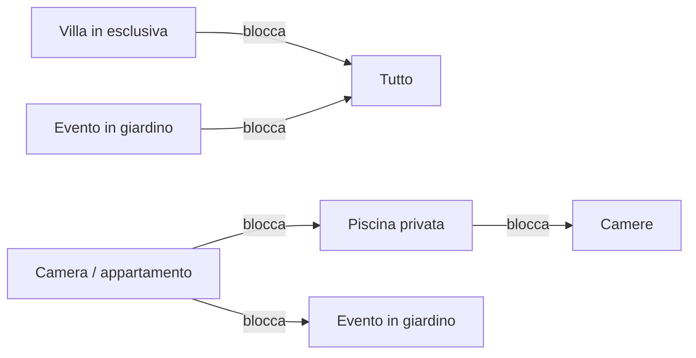

  

<a href="README.md">🇬🇧 English</a> · <b>🇮🇹 Italiano</b>

  
  

> [!NOTE]
> Questo repository è una **vetrina del progetto**: il codice sorgente è privato. Una demo è disponibile su richiesta.

## 🧭 Panoramica

Sito completo per **Villa Valenza**, villa per le vacanze a Favara (Agrigento), con un **sistema di prenotazione multi-tipo**, galleria fotografica, recensioni e un pannello di amministrazione per gestire tutto.

*Progetto per un cliente.*

## ✨ Funzionalità principali

- 🏡 **Sito pubblico**: galleria, appartamenti, recensioni, servizi, FAQ e contatti
- 📅 **Prenotazioni di più tipi**: singoli appartamenti, villa in esclusiva, piscina privata, eventi in giardino
- 🧩 **Regole di disponibilità**: ogni tipo di prenotazione blocca automaticamente quelli in conflitto nelle stesse date, mentre gli appartamenti restano indipendenti tra loro
- 🧾 **Generazione PDF** dei riepiloghi di prenotazione
- 🔐 **Pannello admin** per gestire prenotazioni e disponibilità
- 🚀 **Pubblicato su Vercel**

## 🏗️ Logica delle prenotazioni

## 🧰 Tecnologie

## 📬 Contatti

Realizzato da **Salvatore Cutaia**, ingegnere informatico specializzato in agenti AI e automazioni.

