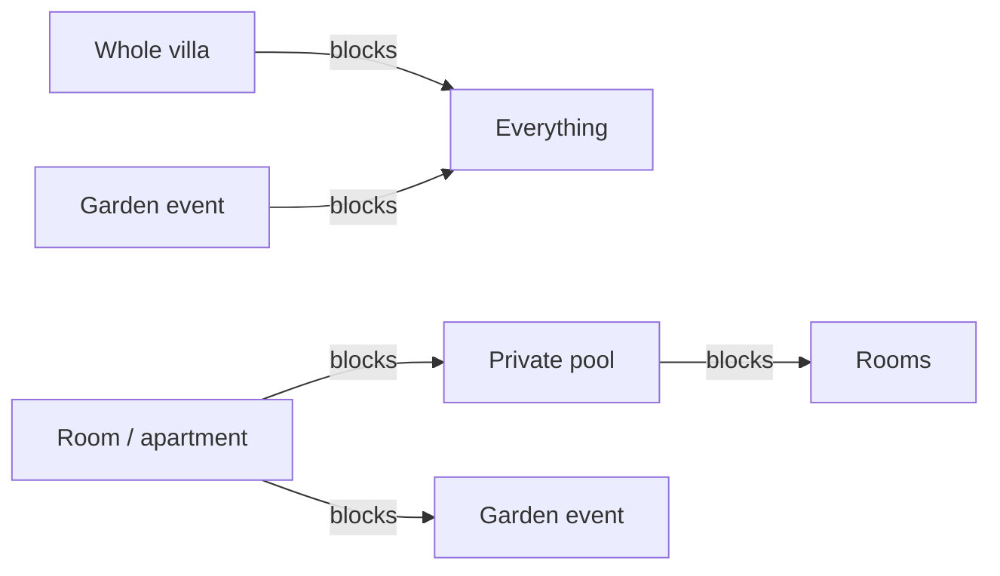

  

  
  

> [!NOTE]
> This repository is a **project showcase**: the source code is private. A demo is available on request.

## 🧭 Overview

Full website for **Villa Valenza**, a holiday villa in Favara (Agrigento, Sicily), with a **multi-type booking system**, photo gallery, reviews and an admin panel to manage everything.

*Client project.*

## ✨ Key features

- 🏡 **Public site**: gallery, apartments, reviews, services, FAQ and contacts
- 📅 **Multi-type bookings**: single apartments, the whole villa, private pool, garden events
- 🧩 **Availability rules**: each booking type automatically blocks the ones it conflicts with on the same dates, while apartments stay independent from each other
- 🧾 **PDF generation** of booking summaries
- 🔐 **Admin panel** to manage bookings and availability
- 🚀 **Deployed on Vercel**

## 🏗️ Booking logic

## 🧰 Tech stack

## 📬 Contact

Built by **Salvatore Cutaia**, Computer Engineer specialized in AI agents & automations.

